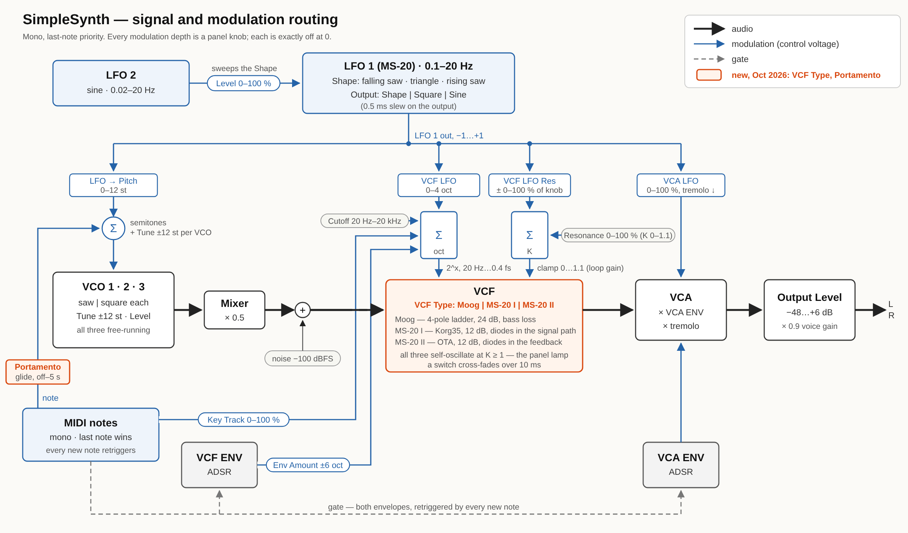
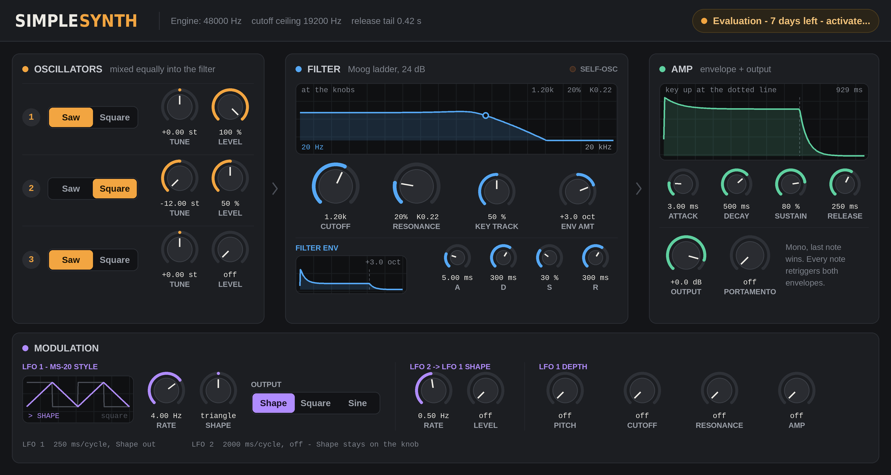

# R2Synth — project notes

A monophonic VST3 + AUv2 synthesiser, written from scratch on the
`../vst3-port-template` scaffold. This file is the record that outlives the
sessions that wrote it.

| Date | What |
|---|---|
| 29 Sep 2026 | Blank scaffold, as **SimpleDrum** (`SiDr`) |
| 29 Sep 2026 | Renamed **SimpleSynth** (`SiSy`, `kInstrumentSynth`, `audio.simplesynth.*`) before any build existed. Class UIDs kept — never shipped, still unique |
| 29 Sep 2026 | The engine and the panel — everything below |
| 10 Oct 2026 | Renamed **R2Synth**, before any public release: an older, well-known free Mac app is already called SimpleSynth (Pete Yandell). Every visible name, the source files, namespace and bundle IDs (`audio.r2synth.*`) changed. **Kept on purpose:** both class UIDs and the AU codes `aumu` / `SiSy` / `AECo`, so projects saved with SimpleSynth builds open with R2Synth in its place, and licence product 0x0101 (now `kProductR2SynthFree`), so codes already issued still activate. Notes below say R2Synth throughout, including for work done under the old name |
| 10 Oct 2026 | **Release kit** (branch `release-kit`): `installer/` from ForTran 1.2.1.0 - build-release.sh, build-installer.sh, publish-release.sh, verify-install.sh (`auval -v aumu SiSy AECo`), distribution.xml, panes, AU postinstall, README, stub suites - plus `tools/check-versions.py`; CMake universal by default (`PORT_UNIVERSAL`, `setup-xcode.sh --native`) and `-ffile-prefix-map`. build-release.sh also refuses a non-https `kActivationUrl` and a development public key (two new stub cases). Installer licence pane is the GPL `LICENSE`. No factory presets yet, so that component is skipped. Release notes for 1.0.0.1 written; nothing built or signed yet |

## The decisions

| Decision | Chosen | Why |
|---|---|---|
| Effect or instrument | **Instrument** — `PlugType::kInstrumentSynth`, AU `aumu`, event input (16 ch) | It is a synthesiser |
| Bus layout | **0 in / 2 out** | Said identically in `initialize`, `setBusArrangements` and the single `SupportedNumChannels` entry in `resource/au-info.plist` |
| Name and codes | `R2Synth` / `SiSy` / `AECo` | `SiSy` checked against FDrm, FTrn, Prj6, SmDr, SDub, SpyB, VcFl — no clash |
| Voices | **Mono, last-note priority**; every new note retriggers both envelopes; releasing the sounding key returns to the last one still held, *without* retriggering | Chosen by Andy — MS-20-like |
| LFO destinations | **Pitch, cutoff and VCA**, each with its own depth | Chosen by Andy |
| Tune | **Per VCO, continuous, ±12 semitones** | Chosen by Andy |
| Panel style | **FilterDrum's** ("the KorgDrum"): its control set lifted, its palette, group boxes and envelope display | The brief |
| Velocity | **Ignored**, like the MS-20's keyboard | Not asked for. `noteOn` still receives it, so adding a sensitivity control is a DSP change only |

## Permanent identity — never change once a build ships

| What | Value |
|---|---|
| Processor UID | `0x6D69A51B, 0xD84BE44A, 0x4927F783, 0x18477FAD` |
| Controller UID | `0x935E5313, 0x9EF72A9E, 0xA1A91CCB, 0x968140F1` |
| AU type / subtype / manufacturer | `aumu` / `SiSy` / `AECo` |
| VST3 bundle id | `audio.r2synth.vst3` |
| AU bundle id | `audio.r2synth.audiounit` |
| Vendor | `AE Cobley` (no full stops — REAPER cuts AU names at the first one); AU name `AE Cobley: R2Synth` |

**The parameter ids are now permanent too.** They were laid out in one go
before any build existed (the scaffold's Output Trim, id 0, became Output
Level); from the first build on, append only.

## The signal path



`docs/routing.svg` is the source (hand-drawn; `routing.png` is a 2× render
of it). Redraw it when a route or a depth range changes.

```
VCO 1 --\                                          LFO (MS-20 MG)
VCO 2 ---+-- mixer --> VCF (Moog | MS-20 I | MS-20 II) --> VCA --> Output Level
VCO 3 --/               ^  ^  ^            ^  ^
                        |  |  key track    |  LFO (tremolo)
                        |  LFO             VCA ENV (ADSR)
                        VCF ENV (ADSR)
```

32 parameters plus bypass, all automatable (Portamento, 6 Oct, and VCF Type, 7 Oct, were appended after the original 30):

| Section | Controls |
|---|---|
| VCO 1, 2, 3 | Wave (Saw / Square), Tune (±12 st), Level (0–100 %) — one implementation, addressed by stride (`vcoParam()`) |
| LFO (1) | Rate (0.1–20 Hz, log), Shape (−100 falling saw … 0 triangle … +100 rising saw), Output (Shape / Square / Sine), Pitch depth (0–12 st) |
| LFO 2 → SHAPE | Rate (0.02–20 Hz, log, default 0.5), Level (0–100 %, default 0) — ids `kLfo2Rate`, `kLfo2Level`, appended after `kVcaRelease` |
| VCF | **Type (Moog / MS-20 I / MS-20 II, default Moog)**, Cutoff (20 Hz–20 kHz, log), Resonance (0–100 % → loop gain 0–1.1), Key Track (0–100 %), LFO depth (0–4 oct) |
| VCF ENV | Attack, Decay, Sustain, Release, Env Amount (±6 oct) |
| VCA / OUTPUT | LFO depth (tremolo, 0–100 %), Output Level (−48…+6 dB) |
| VCA ENV | Attack, Decay, Sustain, Release |

Times are 0.5 ms (attack) / 1 ms (decay, release) to 10 s, log.

### What each block is, and why

- **VCOs**: polyBLEP sawtooth and 50 % square. Free-running — not reset on a
  note — so detuned VCOs beat rather than starting identically. The three
  start a third of a cycle apart after a reset. Tune is smoothed (a pitch
  step through a resonant filter is a click).
- **The MS-20 LFO**: one Shape knob slides the peak of a triangle across the
  cycle — falling saw at one end, triangle in the middle, rising saw at the
  other. The square output's duty **follows the same knob** (50 % at the
  triangle, clamped at 5 %/95 % so it never goes DC), as the MS-20's pulse
  output does. The Output switch picks which one drives all three
  destinations.
- **The LFO's Sine output** (added 29 Sep 2026) is made the way the EMS
  VCS3's oscillators make their sine: the **symmetrical triangle core**
  through a differential-pair shaper, `tanh (kSineDrive · (tri + balance))`,
  rescaled to swing exactly −1…+1 so the depth knobs mean the same on every
  output (`lfoSineValue()`).
  - `kSineDrive = 1.40` was **measured**, not chosen: a 0.01-step sweep for
    the least THD. It gives **1.36 %** (the triangle is 12.1 %). The suite
    checks that 1.30 and 1.50 are both worse.
  - **Shape moves the shaper's balance**, as the VCS3's Shape control moves
    its sine off centre: ±100 % puts the triangle's trough (or peak) on the
    steep middle of the curve and the other extreme into saturation, so one
    half-cycle becomes a broad dome and the other a sharp V — a rectified
    sine, domed on top at +100 % and underneath at −100 %. The same knob
    therefore means *asymmetry* on all three outputs.
  - **Not modelled from a schematic.** I could not find the VCS3's sine
    shaper circuit, so this is the differential-pair principle plus the
    Shape-control behaviour, not a component-level copy of its transfer
    curve.
  - **The Output switch went from two positions to three before any
    release.** Square moved from normalised 1.0 to 0.5, so a test project
    saved on Square opens on Sine. From the first release the positions
    (`LfoOutput`: Shape 0, Square 1, Sine 2) are as permanent as the ids.
- **LFO 2** (added 29 Sep 2026) is a plain sine (`SineLfo`, `std::sin` of
  the phase, free-running) whose only destination is **LFO 1's Shape
  knob**: `sweptLfoShape (knob, level, lfo2) = clamp (knob + level ·
  kMaxLfo2ShapeSweep · lfo2, −1, +1)`, computed every sample before LFO 1
  runs. So the triangle breathes between the two sawtooths, the square's
  duty sweeps (PWM of the LFO), and the sine rocks between its two
  rectified halves.
  - `kMaxLfo2ShapeSweep = 1.0`: full Level from the centre sweeps saw to
    saw. From an off-centre knob the far end is **clamped**, so the wave
    parks at a sawtooth for part of LFO 2's cycle (from +60 %, 37 % of it
    — measured by the suite). The panel's third readout line prints the
    range actually covered, from the same function.
  - **At Level 0 it is bit-identical to the synth before LFO 2** (knob + 0
    is the knob); the suite renders the same patch with two LFO 2 rates
    and compares every sample. The default patch is unchanged (−6.87 dBFS).
  - The Level is smoothed (20 ms); the Rate is not, like LFO 1's.
  - **The LFO display animates with the sweep.** The editor cannot see the
    DSP, so the processor publishes the Shape it is running at as a
    hidden, read-only OUTPUT parameter, `kLfoShapeLive` (id 1001), through
    `data.outputParameterChanges` — at most 60 times a second and only
    when it has moved (`publishLiveShape()`). The editor draws that value;
    when the Shape knob moves it draws the knob until the next live value,
    so the display still follows the knob with no audio running. It is not
    in the table or the state. The caption says "swept by LFO 2" when the
    Level is up. **Needs checking on the Mac**: that Logic (through the AU
    wrapper) and your DAW deliver output parameters to the controller.
  - "Wave shape" was read as LFO 1's Shape because it is the only
    continuous wave-shape control; the VCOs' Wave is a Saw/Square switch.
  - The display draws the **patched** output in green (`> SINE`) and, in
    red, the shape output underneath it, or the square when Shape itself is
    patched (`lfoDisplayData()`, shared with the panel picture). Free-running, bipolar, and slewed by 0.5 ms so a saw reset
  or a square edge on the VCA is not a click. VCA depth is tremolo
  *downwards* from the envelope — it can never lift the level above it.
- **The filter is SpaceDub's Moog ladder** ("Moog VCF, variation 2",
  musicdsp.org), `DelayLine::process`'s per-sample arithmetic unchanged. At
  zero resonance it is **bit-identical** to SpaceDub's loop — a test holds it
  to that against a verbatim copy. Four deliberate differences, all in
  `R2SynthDsp.{h,cpp}`:
  1. **Tuning.** SpaceDub drives it with coefficient = Hz / (fs/4). Measured,
     that puts a 440 Hz request at **332 Hz** and runs sharp above fs/4, and
     differently at every sample rate. `ladderTuning()` builds a 256-point
     table from the filter's own transfer function (the frequency where the
     loop's phase is −180°) so the resonant peak lands on the Cutoff: worst
     error **1.1 cents** at 44.1/48/96 k, measured.
  2. **Resonance as loop gain.** The self-oscillation threshold in
     SpaceDub's terms moves with cutoff (a feedback of 4.01 at 180 Hz, 4.29
     at 12.7 kHz). The same table stores the feedback at loop gain 1, so the
     knob is loop gain: **1.0 sings at every cutoff**, the top ninth of the
     knob self-oscillates, and the panel's lamp lights from the same
     `selfOscillating()` predicate.
  3. **`limitFeedback()`** on the feedback term: linear to 1.5 (so a quiet
     signal sees SpaceDub's filter to the bit — also tested), bending to 3.0.
     It gives self-oscillation an amplitude (≈ −3 dBFS before the VCA);
     SpaceDub's only bound was clamping the state at ±16, which above loop
     gain 1 would be +24 dBFS of sine.
  4. **The state floor is 1e-30, not 1e-15.** At a 30 Hz cutoff on a 192 k
     engine the first pole runs at ~1e-15 of the input and SpaceDub's floor
     zeroed it — the filter could not self-oscillate there. Tested both ways.
  
  Plus a **−100 dBFS noise floor** into the ladder (SpaceDub injected noise
  too): a digital filter started from exact zero never sings, so with every
  VCO off full resonance was silent. The Moog's bass loss at high resonance
  (DC gain 1/(1+fb)) is kept — it is the sound.
- **VCF Type: Moog / MS-20 I / MS-20 II** (branch `MS20Filter`, 7 Oct 2026;
  param `kVcfType`, id 32, Enum Moog = 0 / MS-20 I = 1 / MS-20 II = 2,
  appended — Moog by default so older projects are unchanged; `FilterType`
  in R2SynthDsp.h, values permanent). The two MS-20s follow **Tim
  Stinchcombe, "A Study of the Korg MS10 & MS20 Filters"**, which settles the
  question the first version of this got wrong — where each revision puts
  its diodes:
  - **MS-20 I = the early Korg35 filter** (`Ms20Filter`): a true
    Sallen-Key, `H = 1/(s² + (7/3 − k)s + 1)` (the 7/3 is the first stage
    loaded by the second, `kKorg35Damping`), self-oscillating at k = 7/3, and
    **one back-to-back diode pair in the FORWARD path**, inside the gain
    element whose output is both the filter output and the feedback source.
    Everything heard passes the diodes: the sound gets richer as the input
    gets louder, resonance or not (tested: a 250 Hz sine with no resonance is
    0.00 % THD at 0.1, 12 % at 1.5).
  - **MS-20 II = the later OTA (LM13600) filter** (`Ms20LateFilter`): two
    buffered first-order sections, `H = 1/(s² + (2 − k)s + 1)`, and **strings
    of three back-to-back diodes in the FEEDBACK path**. Only what is fed
    back is bent: the same loud 250 Hz sine passes at 0.5 % THD, while a loud
    sine at the resonant peak gets 0.2 dB of gain against 20 dB linear.
    The input OTA (`otaSaturate`, `kOtaDrive` 0.2) is the only other
    non-linearity modelled.
  - **The diode law**, both filters: a resistor into back-to-back diodes,
    `x = v + eps·sinh(v/Vd)` — off below the knee, a sharp knee, then a
    logarithmic climb with no flat ceiling (unlike tanh).
    `kMs20DiodeSharpness` = 12.8 = 0.6 V / (1.8 × 26 mV); a string of three
    has the SAME sharpness (three times both), only a higher knee. Knees
    `kMs20DiodeKnee` 1.0 (I) and `kMs20LateDiodeKnee` 1.8 (II) were SET BY
    MEASUREMENT, not derived (engine units are not volts).
  - **Solved exactly, zero-delay**: three trapezoidal one-poles (Zavalishin);
    the diodes sit inside the loop, so each sample the diode voltage is the
    root of `(1 − B)v + eps·sinh(v/Vd) = A` (`ms20DiodeSolve()`, B < 1 always;
    Newton started above the root at min(A/(1−B), Vd·asinh(A/eps)),
    monotone, ≤ 16 iterations). For MS-20 I, `A, B` are divided by
    `1 + G(1−G)c`, c = 1/3 (the loading term). Cost ≈ 0.1–0.25 µs a sample.
  - **Same knobs, same meaning**: k = damping × loop gain, so Resonance, the
    LFO's resonance depth, the SELF-OSC lamp and the live outputs mean the
    same on all three filters; tested 0.97 dies / 1.03 sustains at 100 Hz,
    1 kHz, 8 kHz on both MS-20s, singing at the cutoff (±3 %). Corner exactly
    on the knob (prewarped): −6 dB (II) / −7.36 dB (I) at the cutoff with no
    resonance. No bass loss: unity at DC whatever the resonance.
  - **Not modelled**: the Korg35's resonance asymmetry (stronger on the
    negative half-cycle, from its transistors); the OTAs inside MS-20 II's
    loop are taken as linear. Self-oscillation at full resonance: 7.3 % THD
    (I), 4.1 % (II).
  - **Level trims** `kMs20OutputGain` = `kMs20LateOutputGain` = 0.56 (−5 dB),
    measured: each default patch within 0.1 dB RMS of the ladder.
  **Switching** cross-fades linearly over 10 ms (`kFilterCrossfadeSeconds`):
  one weight per filter, each moved in a straight line to its target in the
  same number of samples, so they sum to 1 even when a switch arrives
  mid-fade; filters at weight 0 do not run and are reset; a settled Moog is
  bit-identical to the ladder before the switch existed (tested).
  The filter screen draws `ms20ResponseGain()` with each filter's damping
  (held to both measured filters within 0.25 dB at 27 points each) and its
  caption gives the slope.
- **The cutoff ceiling is 0.40 × fs** (17.6 kHz at 44.1 k, 19.2 kHz at 48 k),
  where the ladder's tuning is still honest; the panel prints it beside the
  engine rate.
- **ADSRs** are RC segments: the attack charges towards 1.3 and stops at 1.0;
  Decay and Release are the time to **−60 dB** of the distance left; the
  envelope runs on to −100 dB before going idle, which takes 5/3 of the
  knob (`releaseTailSeconds()`, which `getTailSamples` reports). Sustain is
  tracked while the key is held. **Retrigger starts from the current level** —
  on a mono synth that retriggers every note, a reset to zero would click on
  every legato phrase.
- **Portamento** (param 31, `kPortamento`, appended 6 Oct 2026 on `UpdatedUI`):
  the VCOs' pitch slides from the last note to the new one in a **straight
  line in semitones, in the knob's time whatever the interval** (1 ms–5 s,
  log). **Always, not only legato**: the pitch is held between notes like an
  analogue keyboard's CV, so a key struck after the previous one was released
  slides too; so does the fall-back to a held key when the sounding one is
  released. A note struck mid-slide starts from where the pitch is. **The
  bottom of the knob is OFF** (`portamentoActive()`, shared by DSP, panel and
  host text) and is the default, so old projects and the default patch are
  unchanged. The first note after a reset never slides. Key tracking follows
  the gliding pitch. Envelopes still retrigger on every note. Knob in the Amp
  section beside Output (mint — every control wears its section's colour).
  Tests: DspTests `testPortamento` (22 checks incl. the audio's period gliding
  110→155→220 Hz, 44.1/48/96 k), ProcessorTests "portamento reaches the voice"
  (live cutoff settles in 0.011 s off, 0.501 s at 500 ms legato AND detached).

## The panel



### The "signal flow" panel (branch `UpdatedUI`, 4 Oct 2026)

From the design `Designs/R2Synth-ConceptA-SignalFlow.png` (the Designs
folder is git-ignored locally via `.git/info/exclude`). 1200 × 640:
a header (wordmark, engine line, licence pill), then OSCILLATORS › FILTER ›
AMP left to right, then a MODULATION strip (LFO 1 scope + Rate/Shape/Output,
LFO 2, and all four LFO 1 depths together). One colour per section — osc
amber, filter blue, amp mint, mod violet — on the knobs' value arcs.
Parameters, controller and processor unchanged.

- **New views in `R2SynthPanelViews.*`** (namespace `Panel`):
  `Backdrop` (everything static, from the layout tables), `Knob`,
  `SegmentSwitch`, `Scope`, `Lamp`. Paths and text only, no bitmaps.
  `R2SynthControls.*` is untouched — the licence dialog still uses
  `SpyPresetButton` — but the panel no longer uses its sliders, boxes or
  envelope view.
- **Knobs**: vertical drag (200 px = full range), Shift ×0.1, double-click
  = the table's default (`setDefaultValue`) — except the three VCO Tunes,
  which go to 0 st (VCO 2's default is −12; 6 Oct) — wheel 1 % a click. The whole
  rectangle, reading and label included, takes the drag. Tune, Shape and
  Env Amount are drawn **bipolar** (arc from the top).
- **Filter screen** = `traceFilterResponse()` (new, `R2SynthDsp`):
  `ladderResponseGain()` closes SpaceDub's stage response round the loop
  (`H = G / (1 + G·fb·z⁻¹)`) and is set up exactly as `process()` sets the
  filter up (ceiling clamp, `ladderTuning()` lookup, resonance × unity
  feedback). **DSP test: within 0.25 dB of a measured `MoogLadder` at 27
  points** (3 cutoffs × 3 resonances × 3 frequencies). At loop gain ≥ 1
  it is drawn at the edge of oscillation (a peak off the top).
- **The filter screen follows the modulation live** (4 Oct): two more
  hidden read-only outputs, **`kCutoffLive` (1002) and `kResonanceLive`
  (1003)**, on exactly `kLfoShapeLive`'s terms — published from
  `process()` through `outputParameterChanges` (`publishLive()` now does
  all three, ≤ 60/s each, only when moved), in `kCutoff`'s / `kResonance`'s
  own normalisation. The screen draws the live curve and dot ("live") with
  the knobs' curve dim behind it; with no live pair yet, or just after a
  knob moves, it shows the knobs ("at the knobs"). Processor tests: the
  envelope's sweep shows in the published cutoff, LFO 1 on the resonance
  swings it both sides of the knob, and nothing moving publishes once.
  The SELF-OSC lamp follows the live resonance too (6 Oct), so it flashes
  when LFO 1 swings the filter into self-oscillation; knob-only until the
  first live value and briefly after the knob moves. Sampled at <= 60/s, so
  a very fast LFO can cross 1.0 between samples.
- **VCF Type switch** (7 Oct; third position 7 Oct): a short segmented switch, Moog | MS-20 I | MS-20 II (228 px), in the
  Filter section's title row where the subtitle "Moog ladder, 24 dB" was
  (`Control::height` = `kTitleSwitchHeight` 24; the layout tests hold it
  between the title and the lamp, above the screen). The screen's caption
  now ends with the slope, "24 dB/oct" or "12 dB/oct", and redraws on a
  switch.
- **Envelope screens**: the filter and amp envelopes now have a screen
  each, but both come from one `traceEnvelopes()` run, so they **share one
  time axis** as the single display did; the amp screen prints the span,
  the filter screen the signed Amount.
- **Licence**: `LicenceBadge::setPill (true)` draws it as a pill in the
  header (amber evaluating, mint licensed); off is the old line. The
  dialog itself is unchanged (old style).
- **Readouts**: the three LFO lines became one info line along the foot of
  the strip (`modInfoLineText()` = LFO 1's line + LFO 2's); the depths line
  went (each depth has its own knob reading). `controlLabel()`,
  `spanText()`, `envAmountText()`, `filterDisplayAnnotation()` are new in
  `R2SynthReadouts.cpp` so the editor and `dump-layout` share them.
- **Tests**: `LayoutTests` rewritten for the new tables (2058 checks:
  every parameter once, no overlaps, each control in its section and
  colour, every reading/label/segment fits, the info line at its longest,
  the filter screen's data); DSP 315; licence 167; Linux validator 47/0,
  processor tests 30/0. `render-panel.py` redrawn for the new look.
- **A new source file**: re-run `./setup-xcode.sh` (or cmake configure) —
  the pre-build source guard will otherwise stop the Xcode build.
- **Left out of the design for now** (no engine support yet): presets +
  Save, Undo, Size, output meter.

### Before: the FilterDrum grid (master)

Four rows in signal order — VCOs, LFO 1 + LFO 2, VCF + VCF ENV,
VCA/OUTPUT + VCA ENV — with an LFO display (both outputs, the patched one marked) and an envelope
display (both ADSRs on one time axis, key-up marked with dots) in a strip on
the right. 1270 × 302 (was 1176 until LFO 1 → resonance).

- **`R2SynthControls.*` is FilterDrum's control set**, namespace renamed,
  plus four opt-in additions — `SpyEnvelopeView::setShowAmounts` and
  `setGateMarker`, `SpySelector::setCompact` and `SpyGroupBox::setTitleBand`
  — see its banner. `diff` it against FilterDrum's to see
  exactly that.
- **The layout is data** in `R2SynthLayout.h`, with no VSTGUI in it.
- **LFO 2 went in without growing the panel.** Its box ("LFO 2 -> SHAPE")
  took columns 4–5 of row 1, which had been readout text. The readouts
  are now three short lines at `columnX (6, 2)` — LFO 1's period and
  output, its depths, LFO 2's period and Shape range; the engine line
  moved to the title row (`kEngineLineX`) and the retrigger note into the
  flow line. The title and flow text live in `R2SynthReadouts.cpp`
  (`panelTitleText()`, `panelFlowText()`) so the picture prints them too.
- **LFO 1 → resonance grew the panel by one column.** "LFO Res"
  (`kVcfLfoRes`, appended after `kLfo2Level`) sits in the VCF box next to
  the cutoff depth, so the VCF and VCA/OUTPUT boxes are five columns and
  both ADSR boxes moved one column right; rows 2–3 are now the widest,
  and `kRowRight` takes the larger of the two candidates. The depth is
  **bipolar round the Resonance knob in the knob's own units** (per cent
  of its travel; loop gain 0..`kMaxResonanceK` internally), clamped to
  0..`kMaxResonanceK` by `lfoResonance()` — so full depth from a knob at 0
  swings into self-oscillation on the LFO's peaks. The lamp still shows
  the knob only. Exactly the knob at depth 0 (tested bit-for-bit).
- **Every string that depends on a value** is made in
  `R2SynthReadouts.cpp`, also VSTGUI-free.
- Both, plus the DSP's trace functions, feed **`tools/dump-layout.cpp`**,
  whose JSON `tools/render-panel.py` draws into `docs/panel.png`. So the
  picture is drawn from the code the editor runs, not from a parsed copy.
- **Box titles are inside the box's view** (`setTitleBand`). FilterDrum's
  SpyGroupBox draws the title 5 px *above* its view, and VSTGUI clips a
  view to its rectangle, so the top half of every title was cut off in the
  plug-in (Andy saw it; `render-panel.py` did not clip, so the picture
  hid it — it clips now). The view now starts at the top of the lettering
  and the frame line runs through it; boxes are 53 px tall round a 44 px
  slider (were 58) with 2 px between rows. **FilterDrum has the same
  clipped titles.**
- **The switches are the height of a slider's bar** (`setCompact`): an
  outlined box exactly where a slider's bar sits, the position's name
  where a slider's reading is, the label ("Wave", "Output") under it. They
  were FilterDrum's full-height selector box until 29 Sep; Andy asked for
  them to match the sliders.

## Bugs found by the Linux validator, and fixed

The SDK validator (see below) found two things a Mac build would have shown
only as odd host behaviour:

1. **Every Log parameter had the wrong default in the host.**
   `RangeParameter`'s constructor computes the default with `toNormalized()`,
   but a virtual call from a base-class constructor reaches the *base's*
   linear version — so LFO Rate's 4 Hz default was published as 0.196
   instead of 0.696 (a host "reset to default" would play 0.28 Hz). Fixed by
   setting `info.defaultNormalizedValue` again in `R2SynthParameter`.
   **FilterDrum has the same bug** — its controller never overrides this, and
   its Cutoff, Attack and Release rows are Log.
2. **Bypass would not parse its own "Off"** — the plain `addParameter`
   bypass FilterDrum uses. Now a `StringListParameter`.

## Traps handled

- **`kBypass` is 1000**, far past the table; `paramDef()` is the only place
  `kParams` is indexed and it range-checks. An instrument's bypass is silence.
- **Never a null title/units to `RangeParameter`.**
- **`setState` resets everything to defaults before reading**; processor and
  controller read the identical layout. The scaffold's one-parameter stream
  still loads (tested) — "append, never insert" at work.
- **Notes are sample-accurate**: `process()` sorts the block's events and
  renders the segments between them. A velocity-0 note-on is a note-off.
- **Parameter-only blocks** still apply their notes. **64-bit hosts** get the
  same samples as 32-bit (tested). The audio thread never allocates; an
  oversize block is refused.
- **Silence flags** are set only when bypassed or the VCA envelope is idle.
- **`getTailSamples`** = VCA release × 5/3 + 0.5 s.
- **The sample-rate message** goes processor → controller from `setActive`
  (UI thread), never from `process()`. The panel falls back to 44.1 k if a
  host never connects the two.
- **`editorDestroyed` compares upcast pointers** — `dynamic_cast` is null
  inside `~EditorView()`.

## Deliberate omissions

| Omitted | The trap when you add it |
|---|---|
| `getProcessContextRequirements` | The LFO is free-running in Hz. The moment anything reads tempo, add the override — code in the banner of `R2SynthProcessor.h` — or the tempo reads 120 in every host and the validator prints `- None` |
| Velocity, pitch bend, mod wheel | VST3 delivers bend and CCs only through `IMidiMapping` to parameters; none is mapped |
| Legato (non-retriggering) envelopes | Every note retriggers, by decision. Portamento exists (6 Oct) and glides regardless of overlap |
| Sample-accurate automation | The last point of each queue is applied per block; the 20 ms smoothers hide the rest |

## Measured levels

From `tests/DspTests.cpp`, printed on every run:

| Case | Peak |
|---|---|
| Default patch, notes C2–C6, at 44.1 / 48 / 96 k | **−6.9 dBFS** |
| Worst case — three squares in unison, full resonance — at 0 dB Output Level | +0.1 dBFS (+6.1 at the +6 dB maximum) |
| Self-oscillation alone, all VCOs off | −5.7 dBFS |
| MS-20 I: default patch | −8.6 dBFS peak; RMS −16.7 dB (ladder −16.6) |
| MS-20 I: worst case at 0 dB Output Level | −7.0 dBFS |
| MS-20 I: self-oscillation alone | −9.3 dBFS |
| MS-20 II: default patch | −7.9 dBFS peak; RMS −16.5 dB (ladder −16.6) |
| MS-20 II: worst case at 0 dB Output Level | −5.2 dBFS |
| MS-20 II: self-oscillation alone | −9.6 dBFS |

`kMixerGain` (0.5) and `kVoiceGain` (0.9) were set from these numbers.

## Verification

Run on 29 Sep 2026 in the cloud workspace (Linux), against VST3 SDK
v3.8.1_build_84 — the tag the template pins:

| What | Result |
|---|---|
| `tools/run-tests.sh` — DSP suite | **249 checks, 0 failures** with LFO 2, on arm64 GCC 11 (the Mac's VM) and x86-64 GCC 13 (201 before LFO 2, 184 before the sine) |
| `tools/run-tests.sh` — layout and panel text | **914 checks, 0 failures** with LFO 2 (812 before) |
| Every `source/*.cpp` compiled against the SDK and VSTGUI headers, `-Wall -Wextra` | 8/8, no warnings in our code; `nm -C`: all 57 referenced `R2Synth::` symbols defined |
| `tools/linux-validate/` — the plug-in built on Linux (editor stubbed), **SDK validator** | **47 tests passed, 0 failed** (re-run after the sine and after LFO 2: still 47 / 0) |
| `tests/ProcessorTests.cpp` against the real processor | **30 checks, 0 failures** with the live-Shape output (25 before) |

Run again in the Mac's own Linux VM (aarch64, GCC 11), which found one
thing: the "quiet signal at resonance 2.5 is SpaceDub's filter to the bit"
check failed at `-O2`. On arm64 GCC fuses SpaceDub's `x -= out4 * fb` into
an FMA, and ours cannot be (it goes through `limitFeedback()`), so the
last bit differs. Codegen, not arithmetic — the suite is now built with
`-ffp-contract=off` and passes there too: **184 / 0 and 804 / 0**. The
plug-in itself is built with the compiler's default contraction; a
last-bit difference from SpaceDub is inaudible.

The negative controls fail when they should: half gain is not bit-identical;
a loud signal at high resonance is limited; with every note's offset forced
to 0 the processor test fails; with SpaceDub's 1e-15 floor the 30 Hz/192 k
self-oscillation test fails.

**Not verified:** the Mac build, VSTGUI actually drawing the panel (the
picture is a reconstruction from the same numbers), the AU wrapper,
`auval`, and listening.

```sh
cd ~/DXi-DEv/R2Synth-VSTi
tools/run-tests.sh                                   # needs external/vst3sdk for the layout suite
python3 tools/render-panel.py                        # redraws docs/panel.png
cmake -S tools/linux-validate -B /tmp/ss-linux -G Ninja \
      -DVST3_SDK_ROOT=$PWD/external/vst3sdk -DCMAKE_BUILD_TYPE=Release
cmake --build /tmp/ss-linux && /tmp/ss-linux/bin/Release/processortests   # Linux only
```

## SDK decision

**In-tree clone**: the first `./setup-xcode.sh` clones the VST3 SDK (~250 MB)
and Apple's AudioUnitSDK into `external/`, which is `.gitignore`d. Chosen so
the project is self-contained and can ship separately.

## Next steps on the Mac

```sh
cd ~/DXi-DEv/R2Synth-VSTi && ./setup-xcode.sh     # new source files: re-run it
# build, watch the validator's post-build output, then:
auval -v aumu SiSy AECo
```

New files were added since the last configure, so **re-run `./setup-xcode.sh`
before building** — otherwise the build compiles the old file list and fails
with *"Bundle does not export the required 'GetPluginFactory' function"* or
the source-manifest guard stops it.

## Licensing (step 1: key format, keypair, Mac tools)

Implements "Licence key format" from the Nag-ware Licensing Design doc.

- Crypto: Monocypher 4.0.2 in `third_party/monocypher/`, using the OPTIONAL
  `monocypher-ed25519.c` = standard RFC 8032 Ed25519 (SHA-512), so Java /
  OpenSSL on the server can sign compatible keys. Monocypher's default
  `crypto_eddsa_*` (BLAKE2b) is NOT compatible. Compile its .c files as C.
- `source/LicenceKey.{h,cpp}` - 81-byte payload, Crockford Base32 `BNDL1-`
  text, name hash (SHA-256 of trimmed, ASCII-lower-cased name; own
  `LicenceSha256.cpp` since Monocypher has no SHA-256), `verifyKey()`.
  Order: format, version, signature, name, blocklist, product (revoked
  before out-of-scope, so a revoked key is never offered an upgrade).
- `tools/licence/LicenceIssue.{h,cpp}` - signing; tools and tests only. Kept OUT of
  `source/` because CMake globs `source/*.cpp` into the plug-in.
- `source/LicenceConfig.h` - per-build knobs: `kEvaluationDays` (7),
  `kAcceptedProducts`, `kRevokedLicenceIds`. None is in the key or the
  licence file, so a rebuild never invalidates a licence or restarts a trial.
- `source/LicencePublicKey.h` - GENERATED, committed. Was the DEVELOPMENT
  key (`36c38c64...6210`, seed `licence-dev/dev-signing-seed.hex`, gitignored,
  0600) until 4 Oct 2026; now the PRODUCTION key (`fa762a61...6c28`,
  `kPublicKeyIsDevelopment = false`, commit 1f5127d) - see "Production
  signing key" below. Dev-signed keys no longer verify.
- Mac tools: `tools/licence/build.sh` -> `build-licence/r2-licence-keygen`,
  `r2-licence-issue --seed licence-dev/dev-signing-seed.hex --name "..." [--id N]`,
  `r2-licence-check "name" "key"` (same checks as the plugin build).
- Tests: `tests/LicenceTests.cpp` in `tools/run-tests.sh` - RFC 8032 and
  SHA-256 vectors, every single-bit tamper, wrong name/product, blocklist,
  and a GOLDEN KEY made by `tools/licence/reference_key.py` (independent
  Python, standing in for the Java server) that the C++ must match exactly.

### Step 2: the plug-in checks for a licence

- `source/LicenceState.{h,cpp}` (pure, tested): the licence file as JSON
  (`firstRun` date, `name`, `key`), the nag decision, the badge text and the
  activation messages, and pulling a name + key out of a pasted email.
- `source/LicenceStore.{h,cpp}` (file I/O, tested): the shared file
  `~/Library/Application Support/R2Project/licence.json` (Windows %APPDATA%,
  Linux XDG), re-read on every call, written via temp file + rename. A missing
  or corrupt file is a fresh evaluation; an unwritable one never errors (an
  activation then lasts until the editor closes).
- `source/LicenceViews.{h,cpp}` (VSTGUI): `LicenceBadge`, one tiny line in the
  bottom margin under the display strip (Layout::kBadge*; the panel did not
  grow), and `LicenceDialog`, drawn inside the panel as a VSTGUI MODAL VIEW
  SESSION (not a native window): Reminder / Enter / Licensed pages; "Paste from
  email" reads the clipboard. CMD+V IS HANDLED BY THE DIALOG
  (LicenceDialog::onKeyboardEvent), not the text field: a macOS text field
  pastes via the host's Edit menu, and Reaper's Edit > Paste is Reaper's own,
  so Cmd+V pasted nothing there (Andy, 29 Sep). VSTGUI offers Cmd keys to the
  frame first (performKeyEquivalent); consuming the event keeps it from the
  host. A key on the clipboard fills both fields from any page; other text
  goes into the focused field. Cmd+C/X/A are still left to the host.
- Editor: `open()` calls `editorOpened()` (writes firstRun the first time any
  editor opens - never at load, so scans and auval see nothing), adds the
  badge, and shows the reminder if due and `claimSessionReminder()` (once per
  process). Dialog buttons close it via `CFrame::doAfterEventProcessing` -
  removing the dialog inside its own button's mouse-up would free the button
  mid-event. `close()` ends any open session first.
- Rules: licensed -> no nag; day 0..kEvaluationDays -> badge counts down;
  after that the reminder on editor open, "Continue evaluating" for ever.
  Buy licence is hidden until LicenceConfig.h gets a buy URL (none yet).
- Testing the clock: `build-licence/r2-licence-trial show | days-ago 8 |
  reset | unlicense`, then restart the host (the reminder is once per session).
- CMake: Monocypher's two C files added to the plug-in with target_sources;
  linux-validate excludes LicenceViews and adds Monocypher. Linux build +
  validator + ProcessorTests pass with the licence code in (29 Sep).
- VERIFIED on the Mac (Andy, 29 Sep): Xcode build; Reaper (VST3) incl. Cmd+V;
  Logic Pro (AU). A licence entered in Reaper was already active in Logic, so
  the sandboxed AU reads the same ~/Library/Application Support/R2Project/
  licence.json - the design doc's sandbox risk is closed, no app-group
  fallback needed. Not yet: auval (should show no UI); docs/panel.png has
  no badge.


### Step 3 (part): free activation codes from the website (branch licence-server, 30 Sep)

- The site (WebPages, branch licence-server) now issues FREE codes at
  https://www.r2-dvd.net/activate.jsp: name + email in, a signed key out,
  recorded in MySQL. Product code **0x0101 `kProductR2SynthFree`**
  (LicenceKey.h), so it never counts as a paid Bundle v1 (0x0001) licence.
  WebPages/LICENSING.md has the server side.
- LicenceConfig.h: `kAcceptedProducts = {kProductBundleV1,
  kProductR2SynthFree}`; `kActivationUrl` (empty = no button).
- Reminder page: new first button **Get activation code** opens
  kActivationUrl in the browser - `openInBrowser()` in LicenceViews.cpp,
  LSOpenCFURLRef (CoreServices, linked in CMakeLists.txt; the deprecation
  warning is silenced), ShellExecuteA on Windows. If it fails the reminder
  shows the URL instead. AssertMacros' un-prefixed macros are switched off
  before CoreServices is included.
- Wording is "activation code" throughout: buttons Enter code / Paste /
  Change code; badge "... - activate..."; activation messages say "code".
  The Licensed page thanks for registering when the key is 0x0101.
- The site's result page offers "Copy name and code", which copies
  "Name: ...\nKey: BNDL1-..." - exactly what extractFromPaste reads, so
  Paste fills both fields.
- Tests (167): this build accepts a 0x0101 key MADE BY THE JAVA SERVER
  (golden string, also in WebPages' LicenceKeyTest), C++ makes the identical
  key, a bundle-only build would refuse it, kActivationUrl is https.
- NOT YET CHECKED on the Mac: the Xcode build (the Apple branch of
  openInBrowser was not compiled here; the Linux branch was), the button
  opening Safari from Reaper and from Logic's sandboxed AU host, and the
  whole round trip against the test server. (All since done - see below.)
- VERIFIED: the round trip (unlicensed -> Get activation code -> activate.jsp
  -> code -> Paste -> activated) against the test server
  http://34.7.233.43 works in Reaper (VST3, 1 Oct) and Logic Pro (AU,
  3 Oct), with the server signing with the DEVELOPMENT seed. DB rows,
  lost-code recovery and rate limits checked by hand; WebPages' registration
  tests pass 76 on real MySQL 9.7.2 (3 Oct).
- **6 Oct: `kActivationUrl` back to the real site,
  `https://www.r2-dvd.net/activate.jsp`** (LicenceConfig.h). The licence
  tests no longer print the "plain http - TEST server" note. Server side
  still to do before the real site takes registrations: deploy the
  licence-server WAR there, and take Andy's test IP out of WebPages'
  context.xml and tools/checkallow.py.

### Production signing key (3-4 Oct 2026)

- Made once on the Mac, offline, WITHOUT `--dev`:
  `build-licence/r2-licence-keygen --seed <outside the repo>/production-signing-seed.hex --header source/LicencePublicKey.h`
- Public key (hex): `fa762a61b93917494c727cc81383335d31b12cf51ed80dc130c9402b79c46c28`.
  Header committed on `licence-server` as 1f5127d.
- The PRIVATE seed lives OUTSIDE the repo (only `licence-dev/` is
  gitignored) and is backed up offline. Never commit or paste it. Losing it
  means no new code will ever work in shipped builds; leaking it lets anyone
  make codes. Replacing the keypair invalidates every code ever issued.
- `r2-licence-issue` / `r2-licence-check` compile the header in: rebuild
  them (`tools/licence/build.sh`) after it changes, and pass the production
  seed to `--seed`.
- The server signs with whatever is in `/etc/r2project/signing-seed.hex`:
  overwrite it with the production seed (mode 600), restart Tomcat, and
  check `LicenceTool pubkey` prints `fa762a61...6c28` (WebPages LICENSING.md).
  The build and the server must switch together - dev-signed codes don't
  verify in this build, and a dev-key build rejects production codes.
- TO DO: rebuild + run-tests.sh, production seed on the test server, one
  full round trip in Reaper and Logic.
